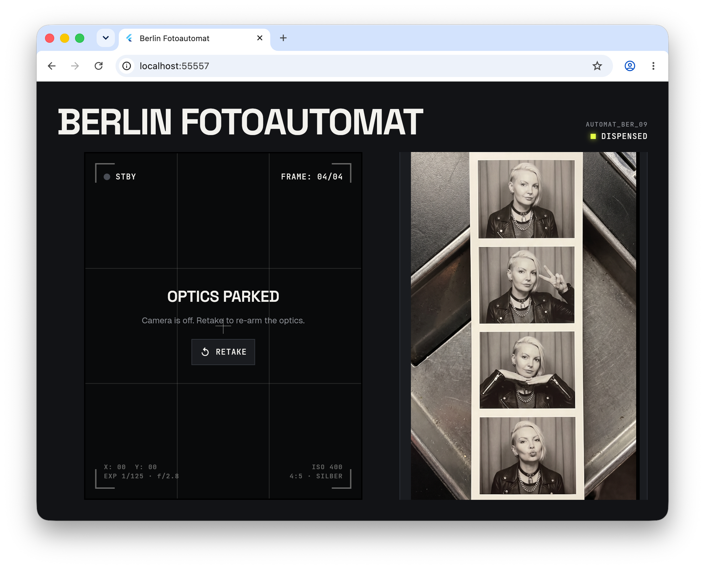

# Berlin Fotoautomat



A Flutter web photo booth. It shoots four webcam frames, then Nano Banana Pro
(`gemini-3-pro-image`) develops them through Firebase AI Logic into a Berlin
Photoautomat strip, with a makeover of piercings, black leather and chains while
every pose and gesture is kept.

## Setup

1. Generate `lib/firebase_options.dart` for your own Firebase project:

   ```bash
   flutterfire configure --project=<your-firebase-project-id>
   ```

   The project needs the Blaze plan (image models have no free tier) and
   Firebase AI Logic enabled with the Gemini Developer API.

2. The app activates App Check with a debug token. Register one in Firebase
   console → App Check → Manage debug tokens, then copy
   `app_check.local.example.json` to `app_check.local.json` and paste the token.
   That file is gitignored.

3. Run:

   ```bash
   flutter run -d chrome --dart-define-from-file=app_check.local.json
   ```
